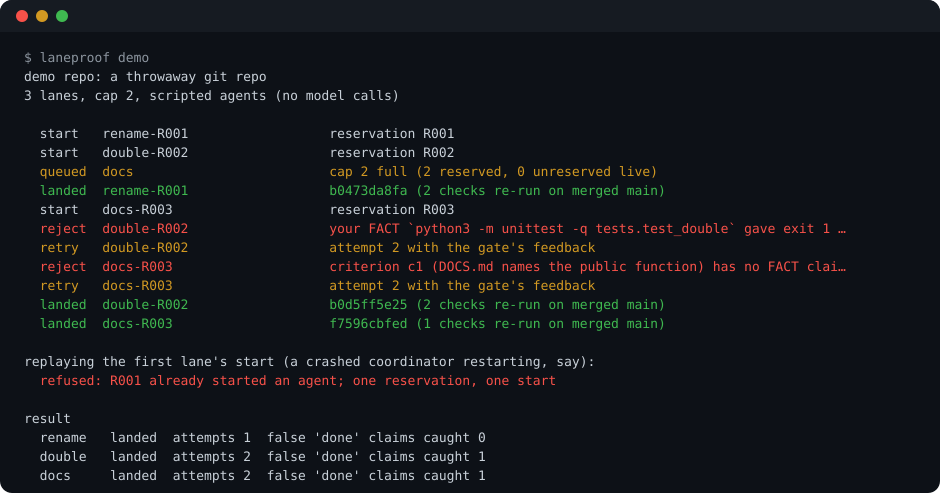
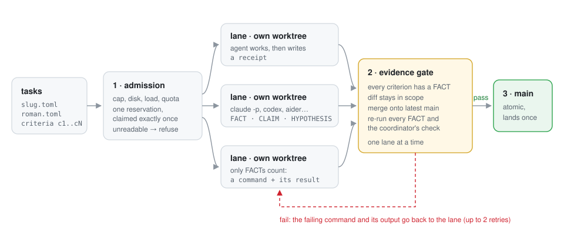

# laneproof

**Run many coding agents in parallel. Count only the work that lands with evidence.**

laneproof is a small coordinator for Claude Code (or any CLI agent). Each agent gets its own git worktree, a
reservation that admits exactly one start, and one way to finish: a receipt of commands that prove each
acceptance criterion. A gate merges the lane onto the latest `main` in a scratch tree, re-runs those commands
there, and only then moves `main`. An agent's "done" is a claim. A landed lane is a fact.

<p align="center"></p>

## The result

84 lanes per condition (8 or 10 coding tasks, 4 at a time, Claude Sonnet 5.5 and Haiku 5.5, 3 runs per cell),
scored against hidden checks the agents never saw:

| how the agents ran | tasks done on `main` | agent's report was wrong | wall clock per run (mean) |
| --- | --- | --- | --- |
| one at a time | 83/84 | 1 | 230 s |
| 4 in one checkout | **84/84** | 16 (said "blocked", was done) | **129 s** |
| 4 in worktrees, merged when the agent says done | 64/84 | 20 (said "done", wasn't on `main`) | 129 s |
| **4 with laneproof** | 73/84 | **0** | 347 s |

**laneproof's status was right for all 84 lanes**: everything it landed passed the hidden checks, and everything
it did not land really was not done. Agents' own reports were wrong 16 to 20 times in 84 when they ran in parallel.
It pays for that with time (about 2.7x a shared checkout) and throughput (11 lanes ran out of retries, mostly on
merge conflicts). Full table, per-lane detail and the honest surprises below.


## Install

```sh
pipx install git+https://github.com/abhaymettu/laneproof    # or: uv tool install git+https://github.com/abhaymettu/laneproof
```

Python 3.11+, standard library only. Agents are whatever CLI you already use; the default is `claude`.

## 30-second quick start

```sh
laneproof demo
```

Three scripted lanes in a throwaway repo, no model calls, about ten seconds. You see the cap hold the third lane
back, a lane whose test passes on its own branch fail once another lane has landed (the gate catches it, the
lane merges `main`, fixes it, lands), a lane that says "docs are clear" with no evidence get sent back, and a
replayed start of a spent reservation get refused.

Then on your own repo:

```sh
laneproof run tasks/ --cap 4            # every tasks/*.toml becomes a lane
laneproof status
```

## A task

```toml
id = "slug"
title = "slugify"
prompt = """Add textkit/slug.py with slugify(text, sep="-") ... and a CLI command `slug`."""
scope = ["textkit/*", "tests/*", "README.md", "CHANGELOG.md"]   # what the lane may touch
protect = ["tests/test_docs.py"]                                 # what it may never touch
check = "python3 -m unittest -q"                                 # yours, run on the merged tree

[[criteria]]
id = "c1"
text = "slugify handles accents, runs of separators and --sep"
```

The lane finishes by writing `.laneproof-receipt.json` (never committed):

```json
{"status": "done",
 "claims": [
   {"criterion": "c1", "label": "FACT", "cmd": "python3 -m unittest tests.test_slug"},
   {"criterion": "c3", "label": "FACT", "cmd": "python3 -m textkit slug 'Héllo, Wörld!'", "stdout_contains": "hello-world"},
   {"label": "HYPOTHESIS", "text": "the regex is fast enough for long inputs"}]}
```

## How it works

<p align="center"></p>

Five ideas, each one small:

1. **Admission is a reservation, and a reservation starts one agent.** `reserve` checks the cap, free disk, load
   and an optional quota command under one file lock, so twenty concurrent callers at cap 4 get exactly four
   grants. `claim` creates a start marker with `O_EXCL` before any process exists, so a crashed coordinator that
   replays its start cannot launch a second agent. Occupancy is observed, not trusted: a live lane process
   counts even if someone released its reservation. Anything unreadable refuses.
2. **Every lane gets its own worktree.** Agents never share a working tree. State lives in `.git/laneproof/`, so
   it is never committed and every worktree sees the same registry.
3. **Claims carry labels.** FACT (a command and the result it should give), CLAIM (someone said so) or
   HYPOTHESIS. Only FACTs count, and every acceptance criterion needs one. A lane that cannot finish writes
   `"status": "asking"` with its question instead of guessing.
4. **Evidence is re-run on the merged result, not the branch.** Work that passes alone can fail together. The
   gate merges the lane onto the current `main` in a scratch worktree, re-runs every FACT and your own check
   there, one lane at a time, and moves `main` by compare-and-swap. A failure goes back to the lane with the
   exact command and output, up to two retries.
5. **Because nothing lands unchecked, merging can be optimistic.** On a textual conflict the gate first tries a
   union merge (keep both sides) in its scratch tree. If every check passes on that, it lands; if not, the lane
   gets the conflict to resolve by hand. Landing is idempotent: the same receipt on the same commit lands once.

## Use it with what you already run

- **Claude Code**: the default adapter runs `claude -p` with stream-json output, resumes the same session with
  the gate's feedback, and records turns and tokens per lane. Pass flags with `--agent-args`.
- **Any other CLI agent**: `laneproof run tasks/ --agent 'codex exec --full-auto {prompt}'` or
  `--agent 'aider --yes-always --message-file {prompt_file}'`. Retries start a fresh run with the feedback appended.
- **Your own orchestrator** (claude-squad, Conductor, agent teams, a shell loop): use the pieces directly.
  `laneproof reserve <holder>` prints an id and token, `laneproof claim <id> <token>` spends it,
  `laneproof verify <lane> <worktree> <task.toml>` gates and lands one worktree, `laneproof release <id>`.
  Exit codes: 0 ok, 1 refused, 2 no headroom, 3 unverifiable.

## Benchmark

```sh
bench/all.sh sonnet 3 4 independent    # 8 independent feature tasks
bench/all.sh sonnet 3 4 coupled        # plus 2 cross-cutting tasks (docsync, --json)
bench/all.sh haiku 3 4 coupled
python3 bench/score.py                 # writes bench/results.md from the raw logs in bench/runs/
```

The fixture is `textkit`, a small Python CLI. Every task adds a module, a subcommand, a README row, a changelog
bullet and tests, so every task touches the same three shared files. The coupled suite adds a task that makes the
README and the registry agree word for word (enforced by a new test) and one that adds a global `--json` flag. The
hidden checker maps each assertion to a stated criterion; the reference solutions pass all of it and the bare fixture
fails all of it. Agents run `claude -p` isolated from the operator's settings, hooks, MCP servers and memory. The
worktree baseline gets the same two conflict-fixing retries as laneproof, so the remaining difference is the gate.

Per cell (from [`bench/results.md`](bench/results.md)):

| model | suite | condition | done | said done, isn't | said not done, is | gate bounces | wall (mean) | tokens (M) |
| --- | --- | --- | --- | --- | --- | --- | --- | --- |
| haiku | coupled | seq | 29/30 | 1 | 0 | - | 326 s | 3.29 |
| haiku | coupled | shared | 30/30 | 0 | 6 | - | 144 s | 4.82 |
| haiku | coupled | worktree | 25/30 | 5 | 0 | - | 171 s | 7.19 |
| haiku | coupled | gated | 26/30 | 0 | 0 | 26 | 404 s | 9.99 |
| sonnet | coupled | seq | 30/30 | 0 | 0 | - | 216 s | 0.97 |
| sonnet | coupled | shared | 30/30 | 0 | 7 | - | 174 s | 1.72 |
| sonnet | coupled | worktree | 23/30 | 7 | 0 | - | 115 s | 2.9 |
| sonnet | coupled | gated | 24/30 | 0 | 0 | 36 | 437 s | 3.0 |
| sonnet | independent | seq | 24/24 | 0 | 0 | - | 148 s | 0.77 |
| sonnet | independent | shared | 24/24 | 0 | 3 | - | 69 s | 1.48 |
| sonnet | independent | worktree | 16/24 | 8 | 0 | - | 102 s | 2.68 |
| sonnet | independent | gated-strict | 7/8 | 0 | 0 | 12 | 810 s | 1.24 |
| sonnet | independent | gated | 23/24 | 0 | 0 | 24 | 201 s | 2.85 |

What surprised me:

- **A shared checkout was the most correct and the fastest.** Claude Code refuses to edit a file that changed since
  it was read, so four agents in one directory never clobbered each other here. The failure was in the reports:
  agents that saw the suite broken by a neighbour's half-finished work said "blocked" for work that ended up done.
- **Worktrees without a gate lose correct work.** 18 of the 20 wrong "done" reports were branches that passed the hidden
  checks on their own and failed them on `main` at the end, mostly unmerged after repeated conflicts as `main` moved.
- **The gate rarely catches bad code; it catches bad integration.** Of 86 bounces, 1 was a lane whose branch was
  wrong on its own. The rest were conflicts and missing evidence. The strict gate (no union merge, one run) took
  810 s for 8 tasks; union merging checked by the gate brought that to about 200 s.
- **Building the benchmark found four bugs**, including one that matters to anyone running `claude -p` in a loop:
  a run can stay alive for minutes after its final `result` event while a background job it started hangs.
  laneproof now treats the `result` event as the end of the run. Details in [RUNLOG.md](RUNLOG.md).


## Where it sits

| | isolates agents | admits starts against headroom | checks claims | checks the merged result |
| --- | --- | --- | --- | --- |
| claude-squad, Conductor, vibe-kanban | worktrees | no (you pick how many) | no | no |
| Sculptor | containers | no | no | no |
| Claude Code subagents / agent teams | shared tree, task list | no | `TaskCompleted` hook can block | no |
| agent-done-or-not, Guildless, agent-gate | n/a (one agent) | n/a | yes, for one agent | no |
| CrewAI, LangGraph, OpenHands | framework-level | no | you build it | no |
| **laneproof** | worktrees | yes, exactly-once | FACT receipts, re-run | **yes, one lane at a time** |

The closest research is CooperBench (arXiv 2601.13295) and "Passes Alone, Fails Together" (arXiv 2609.25396),
which measure how parallel agents break each other's work; Geng and Neubig (arXiv 2603.21489) coordinate
asynchronous agents through git worktrees, commits and merges. laneproof is a tool rather than a benchmark: it turns "re-check on the merged result" into
the only way work reaches `main`, and pairs it with admission control.

## Limits, plainly

- **The gate checks evidence, not intent.** It re-runs the lane's own FACTs and your check. Code that is wrong but
  passes both still lands. In the benchmark, hidden checks (never shown to agents) measure that gap.
- **It costs time.** Landing is serialized and every landing re-runs tests on the merged tree. On tasks that do not
  interact, a shared checkout was the fastest condition here and just as correct.
- **A late lane can run out of retries.** When many lanes edit the same lines, a lane can be bounced by conflicts
  until its two retries are gone while `main` keeps moving. Union merging removes most of these, not all.
- **Small benchmark.** One fixture repo, 8 or 10 tasks, 4 lanes, two models, 3 runs per cell (one strict-gate run). It shows mechanisms
  and orders of magnitude, not a general law. Runs shared the machine with other work, so wall clocks are noisy.
- **Exactly-once is local.** Reservations live in one repository's git directory on one machine. Two machines
  coordinating one repository need a shared lock service this tool does not have.
- **Union merging is optimistic by design.** It is safe only because nothing lands unchecked; with a weak check it
  can land a bad merge. Turn it off with `--no-union`.


## Repository

```
src/laneproof/   admission.py  gate.py  lanes.py  agents.py  demo.py  cli.py
tests/           unit tests, including the demo
bench/           fixture repo, tasks, hidden checks, reference solutions, runner, scorer, raw runs
paper/           the technical report (LaTeX and PDF)
```

MIT licensed. Built by [Abhay Mettu](https://github.com/abhaymettu).
